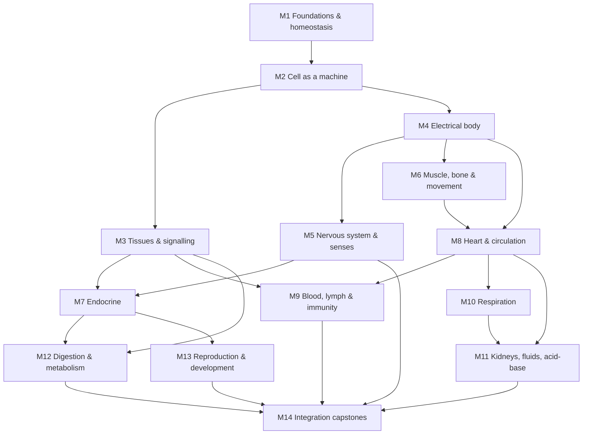
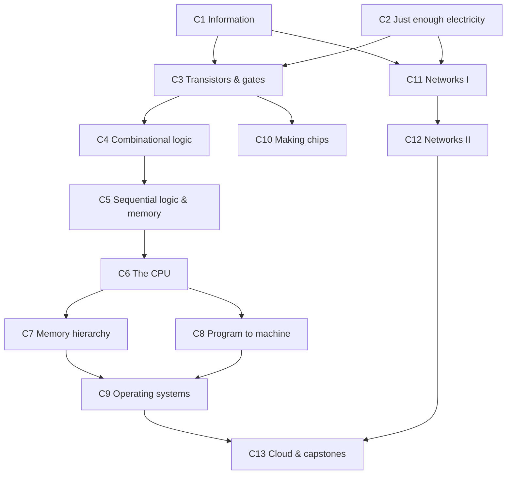
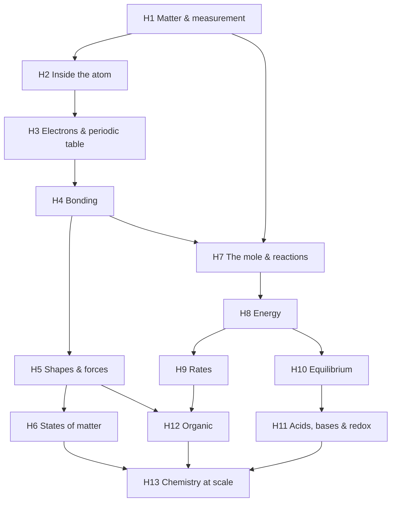

# Which subject should the course channel teach? A research report

*Prepared 22 Oct 2026 (IST). All view and subscriber counts were pulled on this date from YouTube itself (via each playlist or channel page, which YouTube rounds) or from Social Blade. Google Trends figures come from Google Trends' own interface, pulled the same day. Anything marked **estimate** is my judgement and not measured data.*

---

## 0. Answer first

| | |
|---|---|
| **Recommendation** | **"How Your Body Works": human physiology, system by system, from a single cell to the whole person** |
| **Promise** | Watch all of this and you will be able to explain, mechanism by mechanism, how every organ system keeps you alive, and predict what happens when one of them fails, at the level of a first-year nursing or medical physiology course. |
| **Runner-up** | "From Sand to the Cloud": how computers work, from the transistor to the internet |
| **Third** | "Chemistry from Atoms to Industry" |
| **Deciding evidence** | Of every sequential series I measured, Crash Course Anatomy & Physiology holds its views best: its last-quarter episodes still get 0.70× the views of its first-quarter episodes. Crash Course Computer Science gets 0.23× and Crash Course Economics 0.20× ([§E1](#e1-series-view-decay-measured-sequential-pull-proxy)). The subject also has a large, steady exam audience in both target markets: 287,232 AP Biology exams in 2025 ([College Board](https://apcentral.collegeboard.org/media/pdf/program-summary-report-2025.pdf)) and 22,76,069 NEET-UG 2025 registrations ([NTA press release](https://cdnbbsr.s3waas.gov.in/s37bc1ec1d9c3426357e69acd5bf320061/uploads/2025/06/2025061472.pdf)). And mechanisms like these (flows, pumps, gates, cutaways) are what paper-cutout animation does best. |

---

## 1. Method and evidence base

The brief asks for primary data, so I measured things directly wherever I could.

| Evidence type | How it was gathered | Where to verify | Limitation |
|---|---|---|---|
| Series "pull" (how well views hold across an ordered course) | I pulled per-video view counts for 25 ordered playlists. For each, I took the median views of the first quarter of episodes (Q1) and of the last quarter (Q4). The **Q4/Q1 ratio** is my proxy for sequential pull. | Each playlist URL in [§E1](#e1-series-view-decay-measured-sequential-pull-proxy) | This is not audience retention. Public retention curves don't exist for other people's channels. The ratio also mixes in search traffic and teachers assigning single episodes. |
| Channel size and output | Subscriber count and median views of the last 30 uploads, read from the channel page. Total views and video count from Social Blade. | [§E2](#e2-competitor-channels-size-format-weakness) | Subscriber counts are rounded by YouTube. |
| Interest over time | Google Trends, last 5 years, worldwide and India, both web search and YouTube search. Every term is indexed against the anchor "chemistry" = 100. I also computed a seasonality ratio: the average month at peak divided by the average month at trough. | [§E3](#e3-google-trends-relative-interest-anchor-chemistry--100) | These are relative indices, **not search volumes**. I could not get absolute search volumes from any free primary source, so this report contains none. Single words are also ambiguous: "anatomy" picks up searches for *Grey's Anatomy*. |
| Accumulated demand per topic | Total views of the top 10 YouTube search results for a course-style query. | [§E4](#e4-youtube-search-demand-proxy-top-10-results-for-a-course-style-query) | Search results are personalised and depend on location. This measures views already accumulated, not monthly demand. |
| Exam-driven demand | Official exam volumes: College Board AP (2025), NTA NEET-UG (2025), IIT Roorkee GATE (2025). | [§E5](#e5-exam-and-career-anchored-demand-official-figures) | Exam volume tells you an audience exists. It doesn't tell you they watch YouTube. |
| Learning science | Peer-reviewed studies on video length and on background music. | [§E6](#e6-published-research-on-video-length-music-and-course-completion) | Most of this research uses MOOCs and lab settings, not YouTube. |

---

## 2. Step 1: ten candidate domains

| # | Candidate (working title) | Scope: where the ladder starts and where it ends | Why it's on the list |
|---|---|---|---|
| 1 | **How Your Body Works** (human physiology) | Homeostasis → cell → nerve → muscle → each organ system → integrated states such as exercise, altitude, fasting and ageing | The textbook curriculum is formalised in 20 modules with 800+ learning outcomes ([HAPS](https://www.hapsweb.org/haps-learning-outcomes/haps-ap-learning-outcomes-los/)) |
| 2 | **From Sand to the Cloud** (how computers work) | Bits → transistors → gates → CPU → memory → OS → networks → internet → data centres | Matches the scope of nand2tetris and CS:APP. Big career pull |
| 3 | **Chemistry from Atoms to Industry** | Atom → bonding → reactions → energy → equilibrium → acids/redox → organic → industrial processes | The biggest school-science subject by search interest (it's the anchor in §E3) |
| 4 | **Economics from the Price of Bread to Central Banks** | Scarcity → markets → firms → trade → money → banks → macro → central banks → development | Large exam base (AP Macro/Micro, UPSC, Class 11–12 commerce) |
| 5 | **Statistics & Probability from Counting to Inference** | Counting → probability → distributions → sampling → inference → regression → Bayesian | Data careers |
| 6 | **Electricity & Electronics: Electrons to a Working Radio** | Charge → circuits → components → semiconductors → amplifiers → oscillators → radio | A classic mastery ladder |
| 7 | **The Machine World** (mechanical engineering) | Forces → statics → materials → mechanisms → fluids → thermodynamics → engines → turbines | Machine cutaways are a strength of the format |
| 8 | **Planet Earth as a System** | Rocks → plate tectonics → oceans → atmosphere → weather → monsoon → climate → resources | Maps-heavy. UPSC geography demand in India |
| 9 | **Flight: A Complete Ground School** (the surprise pick) | Lift → controls → engines → instruments → weather → navigation → airspace/ATC → performance | Free primary handbooks exist (FAA PHAK). Clear "I can pass the written test" payoff |
| 10 | **How Civilisation Runs** (infrastructure, the second surprise) | Water → sewage → roads → bridges → power grid → telecoms → ports → logistics → food systems | Huge curiosity demand. Close to the existing channel's tone |

---
## 3. Step 2: scoring table (one table; 1 = poor, 5 = excellent)

Shorthand in the cells: **[P]** = playlist decay data in §E1, **[C]** = competitor data in §E2, **[T]** = Trends data in §E3, **[S]** = search-demand data in §E4, **[X]** = exam data in §E5. Every number in a cell has a link in the matching appendix section.

| Candidate | Crit. | Score | One-line justification |
|---|---|---|---|
| 1 Body | a Depth | 5 | HAPS lists 20 modules and 800+ outcomes. Even without clinical topics, that's enough for 200+ non-padded videos. |
| 1 Body | b Retention | 5 | Crash Course A&P holds Q4/Q1 = 0.70 across 47 episodes, the best numbered science series measured. Ninja Nerd GI Physiology holds 0.95 [P]. |
| 1 Body | c Demand | 5 | Year-round: "physiology" seasonality is 1.54 on web and 1.24 on YouTube. Exam base: 287,232 AP Bio exams and 22.76 lakh NEET registrants [T][X]. |
| 1 Body | d Format fit | 5 | Nearly everything is a mechanism (pumps, gates, flows, feedback loops) that cutaways and diagrams teach better than footage. |
| 1 Body | e Competition/gap | 3 | Crowded (Ninja Nerd 4.53M, Osmosis 3.8M, Amoeba Sisters 2.97M, Armando 2.91M, Crash Course 17.2M), but nobody offers a short, ordered, animated, mechanism-first course [C]. |
| 1 Body | f Fact-check | 5 | OpenStax A&P 2e (free), Guyton & Hall, HAPS outcomes, NCERT/NEET syllabus, StatPearls. |
| 1 Body | g Identity payoff | 4 | "I understand my body" is a strong identity. Supports nursing, NEET, MCAT and A&P students. No credential of its own. |
| 1 Body | h Audience | 5 | Global English plus India's NEET cohort, the biggest single exam audience found [X]. |
| 2 Computers | a Depth | 5 | ACM/IEEE CS2023 knowledge areas and nand2tetris/CS:APP scope support 200+ videos. |
| 2 Computers | b Retention | 3 | Crash Course CS Q4/Q1 = 0.23, Branch "How do Computers Work?" 0.16, Ben Eater 8-bit computer 0.40 [P]. |
| 2 Computers | c Demand | 4 | 207,851 GATE CS registrants and 175,174 AP CSP exams [X]. "Computer" is the highest term measured (306 vs chemistry 100, web), but it's generic [T]. |
| 2 Computers | d Format fit | 4 | Hardware and networking animate superbly. OS and compiler topics tempt you toward code on screen, which the format penalises. |
| 2 Computers | e Competition/gap | 4 | Branch Education (2.77M) has only 69 videos in 8 years. Core Dumped (514K, 51 videos) is close in format. Computerphile is talking heads. Neso and Gate Smashers are whiteboard lectures [C]. |
| 2 Computers | f Fact-check | 5 | IETF RFCs, ISA manuals, Patterson & Hennessy, CS:APP, Kurose & Ross. |
| 2 Computers | g Identity payoff | 5 | "I know what happens from keypress to packet" is valuable in interviews and GATE. A sellable course is plausible. |
| 2 Computers | h Audience | 5 | Global, and India has the largest GATE paper [X]. |
| 3 Chemistry | a Depth | 5 | General plus organic plus industrial chemistry easily fills 200+ videos (OpenStax Chemistry 2e alone has 21 chapters). |
| 3 Chemistry | b Retention | 4 | Crash Course Chemistry Q4/Q1 = 0.43 over 46 episodes [P]. |
| 3 Chemistry | c Demand | 5 | Highest school-subject index (it's the anchor). Peaks in February in India, which matches the JEE/NEET/boards calendar (YouTube seasonality 1.63) [T]. 168,833 AP Chem exams [X]. |
| 3 Chemistry | d Format fit | 4 | Molecules, orbitals and reactions animate well. The audience expects lab demos the format can't show. |
| 3 Chemistry | e Competition/gap | 2 | The Organic Chemistry Tutor (11.1M), Professor Dave (4.48M), Tyler DeWitt (1.61M), Physics Wallah (14.4M) in India, NileRed (11M) [C]. |
| 3 Chemistry | f Fact-check | 5 | IUPAC, NIST WebBook, OpenStax, AP Chem CED, NCERT. |
| 3 Chemistry | g Identity payoff | 3 | Mostly an exam payoff. "I understand chemistry" is a weaker adult identity than body or computers (**estimate**). |
| 3 Chemistry | h Audience | 5 | Global plus India (JEE and NEET both test chemistry). |
| 4 Economics | a Depth | 5 | CORE *The Economy* plus a macro/monetary sequence fills 200+ videos. |
| 4 Economics | b Retention | 3 | Crash Course Econ Q4/Q1 = 0.20, but the first quarter averages a high 3.45M [P]. |
| 4 Economics | c Demand | 4 | 176,356 AP Macro and 117,548 AP Micro exams [X]. India web index is 43 vs chemistry 100 [T]. Peaks around news cycles. |
| 4 Economics | d Format fit | 4 | Curves, flows, maps and balance sheets animate well. Heavy reliance on data charts. |
| 4 Economics | e Competition/gap | 3 | Economics Explained 2.89M, How Money Works 1.76M, Money & Macro 679K, Think School 6.6M (India). All commentary rather than a course. MRU (420K) is a course, but recent uploads get a median of 1,250 views [C]. |
| 4 Economics | f Fact-check | 4 | Data is excellent (RBI, FRED, World Bank). The theory itself is contested, so claims need framing. |
| 4 Economics | g Identity payoff | 4 | "I understand the news and money." Useful for UPSC and AP. |
| 4 Economics | h Audience | 5 | Global, with strong India interest [T]. |
| 5 Statistics | a Depth | 5 | Counting to Bayesian modelling is a deep ladder. |
| 5 Statistics | b Retention | 2 | Crash Course Statistics Q4/Q1 = 0.14, the worst measured. StatQuest Fundamentals 0.47 [P]. |
| 5 Statistics | c Demand | 4 | 266,791 AP Stats exams [X]. Strong exam peaks (India YouTube seasonality 2.09) but lower always-on YouTube interest (index 11.6) [T]. |
| 5 Statistics | d Format fit | 3 | Distributions animate well. Inference needs notation and worked numbers, which is close to "writing on screen". |
| 5 Statistics | e Competition/gap | 3 | StatQuest 1.71M, 3Blue1Brown 8.71M (partial coverage), zedstatistics 277K, jbstatistics 230K, Khan 9.49M [C]. |
| 5 Statistics | f Fact-check | 5 | Textbook-stable maths. NIST/SEMATECH e-Handbook. |
| 5 Statistics | g Identity payoff | 5 | "I can read and run an analysis" leads straight to data jobs. |
| 5 Statistics | h Audience | 4 | Global. India demand is exam-driven [T]. |
| 6 Electronics | a Depth | 4 | Deep enough, but the curriculum tends to bend toward hands-on building. |
| 6 Electronics | b Retention | 3 | Engineering Mindset Electricity Basics 0.44, Ben Eater 8-bit computer 0.40 [P]. |
| 6 Electronics | c Demand | 4 | "Electricity" scores 74 on web and 15.6 on YouTube (chemistry = 100) [T]. 97,394 GATE EC and 83,355 GATE EE registrants [X]. |
| 6 Electronics | d Format fit | 4 | Fields and current flow animate well. The hobbyist audience expects bench footage. |
| 6 Electronics | e Competition/gap | 2 | The Engineering Mindset (4.49M) already does exactly this in animation. ElectroBOOM 8.9M, GreatScott! 2.17M [C]. |
| 6 Electronics | f Fact-check | 5 | Physics and datasheets. |
| 6 Electronics | g Identity payoff | 4 | "I can build a radio", but only if the viewer also builds, which the format can't show. |
| 6 Electronics | h Audience | 4 | Global, with an Indian engineering base. |
| 7 Machines | a Depth | 4 | Statics → thermodynamics → engines is real depth. Thinner at the advanced end without equations. |
| 7 Machines | b Retention | 3 | Crash Course Engineering 0.26. The Efficient Engineer's playlists are mostly 5-video playlists, too short to judge [P]. |
| 7 Machines | c Demand | 3 | "Mechanical engineering" scores 10.9 on web (chemistry = 100) [T]. 79,830 GATE ME registrants [X]. But "how engines work" top-10 results total 50.8M views [S]. |
| 7 Machines | d Format fit | 5 | Cutaways of gearboxes and engines are the native strength of the format. |
| 7 Machines | e Competition/gap | 2 | Jared Owen 4.44M, Animagraffs 1.94M, The Efficient Engineer 1.51M, Engineering Explained 4.23M, Real Engineering 5.12M [C]. |
| 7 Machines | f Fact-check | 4 | Textbooks and manufacturer data are available. Some designs are proprietary. |
| 7 Machines | g Identity payoff | 3 | "I understand machines." Weak link to a product (**estimate**). |
| 7 Machines | h Audience | 4 | Global. India engineering students. |
| 8 Earth | a Depth | 4 | Solid curriculum. Prerequisite chains are shorter than in sciences built on physics. |
| 8 Earth | b Retention | 3 | Crash Course Geography 0.53, but small: Q1 median 454K [P]. |
| 8 Earth | c Demand | 3 | 282,781 AP Human Geography and 245,371 AP Env Sci exams [X]. "Geography" index is 42–47 [T]. "Monsoon explained" top-10 results total only 1.9M [S]. |
| 8 Earth | d Format fit | 5 | Maps and Earth cross-sections suit paper cutout perfectly. |
| 8 Earth | e Competition/gap | 4 | RealLifeLore 7.94M and Geography Now 3.93M are not courses. Crash Course Geography's whole series totals only 18.6M views [C][P]. |
| 8 Earth | f Fact-check | 5 | USGS, NOAA, IMD, IPCC. |
| 8 Earth | g Identity payoff | 3 | Strong for UPSC aspirants, weaker as a global identity. |
| 8 Earth | h Audience | 4 | Global, with UPSC demand in India. |
| 9 Flight | a Depth | 4 | FAA PHAK, the Airplane Flying Handbook, weather and navigation give real depth. |
| 9 Flight | b Retention | 3 | No ordered ground-school playlist of meaningful size was found to measure. This score is an **estimate**. |
| 9 Flight | c Demand | 1 | "Pilot training" scores 1.9 on web and ~0 on YouTube [T]. "Private pilot ground school" top-10 results total 2.85M views [S]. |
| 9 Flight | d Format fit | 4 | Aerodynamics and instruments animate well. Audiences expect cockpit footage. |
| 9 Flight | e Competition/gap | 3 | Mentour Pilot (2.52M) does accident stories rather than a course. Dedicated ground-school channels are small [S]. |
| 9 Flight | f Fact-check | 5 | FAA handbooks and regulations are free primary sources. |
| 9 Flight | g Identity payoff | 4 | "I passed my written test" is concrete. |
| 9 Flight | h Audience | 2 | Regulation-specific (FAA vs DGCA). India aviation YouTube index is only 1.1 [T]. |
| 10 Infrastructure | a Depth | 3 | Wide but loosely connected: few true prerequisites, so it risks being a playlist rather than a course. |
| 10 Infrastructure | b Retention | 2 | The best channels here are standalone episodes, with no sequential series to point to (**estimate**). |
| 10 Infrastructure | c Demand | 3 | "How the power grid works" top-10 results total 16.6M views [S]. "Civil engineering" scores 12.4 [T]. 101,596 GATE CE registrants [X]. |
| 10 Infrastructure | d Format fit | 5 | Cutaways of plants and networks fit the format perfectly. |
| 10 Infrastructure | e Competition/gap | 2 | Practical Engineering 4.84M, Wendover 4.92M, Real Engineering 5.12M, Animagraffs 1.94M [C]. |
| 10 Infrastructure | f Fact-check | 4 | Standards and agency reports exist but vary by country. |
| 10 Infrastructure | g Identity payoff | 2 | "I understand how things run" is real, but there's no credential path. |
| 10 Infrastructure | h Audience | 4 | Global. India's infrastructure boom adds interest (**estimate**). |

### Totals

| Rank | Candidate | a | b | c | d | e | f | g | h | **Total /40** |
|---|---|---|---|---|---|---|---|---|---|---|
| 1 | Body | 5 | 5 | 5 | 5 | 3 | 5 | 4 | 5 | **37** |
| 2 | Computers | 5 | 3 | 4 | 4 | 4 | 5 | 5 | 5 | **35** |
| 3 | Chemistry | 5 | 4 | 5 | 4 | 2 | 5 | 3 | 5 | **33** |
| 4 | Economics | 5 | 3 | 4 | 4 | 3 | 4 | 4 | 5 | **32** |
| 5= | Statistics | 5 | 2 | 4 | 3 | 3 | 5 | 5 | 4 | **31** |
| 5= | Earth | 4 | 3 | 3 | 5 | 4 | 5 | 3 | 4 | **31** |
| 7 | Electronics | 4 | 3 | 4 | 4 | 2 | 5 | 4 | 4 | **30** |
| 8 | Machines | 4 | 3 | 3 | 5 | 2 | 4 | 3 | 4 | **28** |
| 9 | Flight | 4 | 3 | 1 | 4 | 3 | 5 | 4 | 2 | **26** |
| 10 | Infrastructure | 3 | 2 | 3 | 5 | 2 | 4 | 2 | 4 | **25** |

**Sensitivity check:** If format fit (d) and retention (b) count double, because they are what make *this* channel work, the order becomes Body 47, Computers 42, Chemistry 41, Economics 39, Earth 39. The top three don't change.

---
## 4. Step 3: the top three

### 4.1 Top pick #1: How Your Body Works (human physiology)

**Promise.** Watch all of this and you will be able to explain, mechanism by mechanism, how every organ system keeps you alive, and predict what happens when one of them fails, at the level of a first-year nursing or medical physiology course.

#### Curriculum map (14 modules; video counts are **estimates**)

| Module | Learning outcome ("after this module you can…") | Videos (est.) |
|---|---|---|
| M1 Foundations: body plan & homeostasis | Explain any regulated variable as a sensor, controller and effector loop. Tell negative from positive feedback. | 8 |
| M2 The cell as a machine | Explain membranes, transport, ATP and protein synthesis as physical processes. | 12 |
| M3 Tissues & chemical signalling | Explain how cells signal one another (receptors, second messengers) and what the 4 tissue types do. | 6 |
| M4 The electrical body | Derive the resting potential from ion gradients. Walk through an action potential and a synapse step by step. | 12 |
| M5 Nervous system & senses | Trace a signal from receptor to brain to effector. Explain reflexes, the autonomic system and each sense. | 22 |
| M6 Muscle, bone & movement | Explain the sliding filament mechanism, the three muscle types, levers and bone remodelling. | 14 |
| M7 Endocrine system | Predict the effects of any hormone axis (hypothalamus → pituitary → gland) and its feedback. | 16 |
| M8 Heart & circulation | Explain the cardiac cycle, conduction, blood pressure control and capillary exchange. | 20 |
| M9 Blood, lymph & immunity | Explain clotting, oxygen carriage, innate vs adaptive immunity, and vaccines. | 20 |
| M10 Respiration | Explain ventilation mechanics, gas exchange, O₂/CO₂ transport and the control of breathing. | 14 |
| M11 Kidneys, fluids & acid-base | Explain filtration, reabsorption, concentrating urine, and pH buffering across lungs and kidney. | 18 |
| M12 Digestion, nutrition & metabolism | Follow a meal from mouth to ATP. Explain insulin and glucagon, fasting and feeding. | 20 |
| M13 Reproduction, development & heredity | Explain the reproductive cycles, fertilisation, embryonic development and inheritance basics. | 16 |
| M14 Integration capstones | Predict whole-body responses to exercise, altitude, heat, haemorrhage, fasting, sleep and ageing. | 12 |
| **Total** | | **≈210 (estimate)** |

#### Prerequisite graph

Text version: M1 → M2 → {M3, M4}. M4 → {M5, M6}. {M3, M5} → M7. {M4, M6} → M8 → {M9 (also needs M3), M10}. {M8, M10} → M11. {M3, M7} → M12. M7 → M13. {M5, M9, M11, M12, M13} → M14.

#### First 30 videos, in watching order

| # | Title | Hook (the question it answers) | Module |
|---|---|---|---|
| 1 | What Your Body Is Really Doing Every Second | What does "staying alive" actually require of 37 trillion cells working together? *(The cell count comes from Bianconi et al. 2013, [doi:10.3109/03014460.2013.807878](https://doi.org/10.3109/03014460.2013.807878).)* | M1 |
| 2 | Homeostasis: The Thermostat Inside You | How does your temperature barely move whether you're in a Rajasthan summer or a Ladakh winter? | M1 |
| 3 | Negative Feedback: The Loop That Runs Your Life | Why do almost all body systems push back against change? | M1 |
| 4 | Positive Feedback: When the Body Hits the Accelerator | Why do childbirth and blood clotting speed up instead of settling down? | M1 |
| 5 | A Map of You: Planes, Cavities and Compartments | Where is everything, and why are organs packed into sacs? | M1 |
| 6 | Water Everywhere: The Body's Fluid Compartments | If you're mostly water, where exactly is it kept, and what keeps it there? | M1 |
| 7 | Levels of Organisation: Atom to Organism | How do lifeless molecules add up to a living person? | M1 |
| 8 | Capstone: Why You Shiver | How do sensor, controller and effector combine in one everyday reflex? | M1 |
| 9 | The Cell Membrane: A Wall That Chooses | How does a wall a few molecules thick decide what gets in? | M2 |
| 10 | Diffusion: Why Molecules Spread Out | How does oxygen get anywhere without being pushed? | M2 |
| 11 | Osmosis: Why Seawater Can't Quench Thirst | Why does drinking salt water dehydrate you? | M2 |
| 12 | Channels and Carriers: Doors in the Membrane | How do cells let in the molecules that can't slip through the membrane? | M2 |
| 13 | The Sodium–Potassium Pump | Why does nearly every cell run a pump that never stops? | M2 |
| 14 | ATP: The Body's Rechargeable Battery | What is the energy currency, and how is it spent? | M2 |
| 15 | Mitochondria: Burning Food Without Fire | How do you release a meal's energy without combustion? | M2 |
| 16 | Enzymes: Why Chemistry Inside You Is So Fast | How do reactions that would take years outside the body happen in milliseconds inside it? | M2 |
| 17 | DNA to Protein: The Cell's Assembly Line | How does a gene become a working machine? | M2 |
| 18 | Vesicles: The Cell's Shipping Service | How do cells export hormones and import big things? | M2 |
| 19 | How Cells Divide (and Why They Usually Stop) | What keeps tissue growth under control? | M2 |
| 20 | Capstone: One Second in the Life of a Cell | Every mechanism from M2 running at the same moment | M2 |
| 21 | Four Tissues Build Everything | Why do only four tissue types make up every organ? | M3 |
| 22 | Epithelium: The Body's Borders | How do linings both protect and absorb? | M3 |
| 23 | Connective Tissue: The Body's Scaffolding | What do bone, blood and fat have in common? | M3 |
| 24 | How Cells Talk: Chemical Messengers | What are the four ways one cell sends a message to another? | M3 |
| 25 | Receptors: Locks, Keys and Amplifiers | How can a tiny trace of hormone change a whole organ? | M3 |
| 26 | Second Messengers: One Signal, a Thousand Responses | How does a signal outside the cell switch on machinery inside it? | M3 |
| 27 | Why Every Cell Is a Battery: The Resting Potential | Where does the voltage across a cell come from? | M4 |
| 28 | Ion Channels: Gates That Open on Command | How do voltage, chemicals and stretch open a pore? | M4 |
| 29 | The Action Potential, Step by Step | Exactly what happens in a nerve impulse, millisecond by millisecond? | M4 |
| 30 | Why Nerve Signals Don't Fade: Myelin and Saltatory Conduction | How does a signal cross a metre of nerve without weakening? | M4 |

#### Retention design

- **Cliffhanger rule.** Each video ends on a question the next video answers, built into the script's last 20 seconds. Example: video 13 ends "the pump runs on ATP, so where does ATP come from?" and video 14 answers it. Don't use generic "subscribe" outros. The end screen shows exactly one card: the next video.
- **Capstones** sit at the end of every module (videos 8 and 20, then roughly every 10–20 videos). Each one runs a single real scenario through every mechanism in the module. Module 14 is a full capstone *module*: exercise, altitude and haemorrhage pay off everything that came before.
- **Entry mid-series.** Every video opens with a cold open of 15 seconds or less, then a "you need to know" recap of 20 seconds or less showing the two prerequisite ideas as icons, with a card to each. Each module also gets a "Start here" video, which is its first video, written so a newcomer can start there.
- **Why chunk at 6–9 minutes.** The largest published video-engagement study (6.9M edX sessions) found median engagement time capped at about 6 minutes, and viewers often stopped before halfway in videos over 9 minutes ([Guo, Kim & Rubin 2014](https://up.csail.mit.edu/other-pubs/las2014-pguo-engagement.pdf)). A for-credit setting showed longer tolerance ([Lagerstrom et al. 2015](https://peer.asee.org/the-myth-of-the-six-minute-rule-student-engagement-with-online-videos.pdf)). Your 6–9 minute length sits at the right edge of that evidence, so aim at 6–7 minutes.
- **No music is a feature, not a cost.** Background music lowered retention and transfer in an animation-plus-narration lesson ([Moreno & Mayer 2000](https://tecfa.unige.ch/tecfa/teaching/methodo/Moreno_Mayer00.pdf)). Keep it that way.

#### Packaging

- **Title grammar:** `[Plain question or mechanism claim] | Body Course M#.#`. Examples: "Why Seawater Can't Quench Thirst | Body Course 2.3", "The Action Potential, Step by Step | Body Course 4.3". Front-load the searchable noun (osmosis, nephron, action potential), because the evidence shows physiology series hold views through per-topic search ([§E1](#e1-series-view-decay-measured-sequential-pull-proxy), [§E4](#e4-youtube-search-demand-proxy-top-10-results-for-a-course-style-query)).
- **Thumbnails:** one paper-cutout organ or cell cutaway, one bold arrow or flow, at most three words ("SEAWATER = THIRST?"), and a module-colour stripe with the code "4.3" in the corner. The series reads as a colour-coded spine on the channel page. Keep it stylised and non-gory so it stays advertiser-friendly.
- **Playlists:** (1) "The Full Course, In Order", the master list. (2) One playlist per module. (3) Exam overlays that pull existing videos into exam order: "NEET Human Physiology (NCERT Unit 5)", "A&P 1" and "A&P 2" following the HAPS module order. (4) "Capstones only", for review.

#### Five primary sources to check every claim against

1. **OpenStax, *Anatomy and Physiology 2e*** (free, peer-reviewed): https://openstax.org/details/books/anatomy-and-physiology-2e
2. **Hall & Hall, *Guyton and Hall Textbook of Medical Physiology*** (the standard medical text): https://shop.elsevier.com/books/guyton-and-hall-textbook-of-medical-physiology/hall/978-0-323-59712-8
3. **HAPS Anatomy & Physiology Learning Outcomes** (20 modules; this is the curriculum spine): https://www.hapsweb.org/wp-content/uploads/2024/09/AP-Learning-Outcomes-PDF.pdf
4. **NTA/NMC NEET-UG syllabus**, with NCERT Class 11 Biology (Human Physiology unit) as the India alignment: https://neet.nta.nic.in/document/syllabus-for-neet-ug-2025-examination-reg/
5. **StatPearls (NCBI Bookshelf)**, peer-reviewed and topic-level, for anything that edges into clinical territory: https://www.ncbi.nlm.nih.gov/books/NBK430685/

#### Risks and what would make it fail

| Risk | Why it matters | Mitigation |
|---|---|---|
| Health-misinformation and trust policies | YouTube's health source labels and health shelves are only for licensed professionals or organisations ([YouTube Help](https://support.google.com/youtube/answer/12796915)). An unlicensed channel gets no label. | Teach **normal function** (physiology), not diagnosis or treatment. Cite sources in every description. Recruit a credentialed reviewer (physician or physiology lecturer) to sign off scripts and name them on screen. |
| Daily output vs accuracy | One video a day with synthetic narration risks errors and looks like "mass-produced" content. YouTube's July 2025 "inauthentic content" clarification targets repetitive, template-like uploads ([YouTube monetization policies](https://support.google.com/youtube/answer/1311392)). | Make each script visibly original. Keep a fact-check log per video. Consider 4–5 per week on this channel. |
| Strong incumbents | Osmosis (3.8M, 1,927 videos) and Ninja Nerd (4.53M, 708 videos) own med-student search terms [C]. | Position *before* them: a mechanism-first course for curious adults, A&P students and NEET aspirants, rather than a pathology review for medical students. |
| Medical pronunciation by TTS | Mispronounced terms destroy credibility. | Keep a pronunciation lexicon (SSML phonemes) and add on-screen labels for every term. |
| The early modules have the least search demand | M1–M2 are abstract, while big-search topics (heart, immune system, action potential) arrive later [S]. | Publish the course in order, but interleave one "search magnet" standalone (heart or immunity preview) per week, linking back to the course. |

---
### 4.2 Top pick #2: From Sand to the Cloud (how computers work)

**Promise.** Watch all of this and you will be able to explain what physically happens, from electrons in a transistor to packets crossing an ocean, when you tap a link, covering the scope of nand2tetris plus a first systems and networking course.

#### Curriculum map (13 modules; counts are **estimates**)

| Module | Learning outcome | Videos (est.) |
|---|---|---|
| C1 Information | Encode numbers, text, images and sound as bits. Explain binary, hex and two's complement. | 9 |
| C2 Just enough electricity | Explain voltage, current, resistance and semiconductors as a mechanical analogy and the real physics. | 5 |
| C3 Transistors & gates | Build every logic gate from transistors. Explain CMOS. | 6 |
| C4 Combinational logic | Build adders, multiplexers, decoders and an ALU. | 6 |
| C5 Sequential logic & memory | Explain latches, flip-flops, clocks, registers, SRAM and DRAM. | 14 |
| C6 The CPU | Trace fetch–decode–execute through a datapath. Explain ISAs and pipelining. | 24 |
| C7 Memory hierarchy & storage | Explain caches, locality, virtual memory hardware, SSDs and HDDs. | 14 |
| C8 From program to machine | Show how source becomes machine code (compiler, assembler, linker), entirely as diagrams with no typed code. | 14 |
| C9 Operating systems | Explain processes, scheduling, system calls, virtual memory and file systems. | 24 |
| C10 Making chips | Explain lithography, fabs, Moore's law, GPUs and accelerators. | 12 |
| C11 Networks I: physical to IP | Explain signals, Ethernet, Wi-Fi, IP addressing and routing. | 20 |
| C12 Networks II: the Internet | Explain TCP, DNS, HTTP, TLS and public-key cryptography. | 20 |
| C13 The cloud & capstones | Explain data centres, databases, CDNs and distributed consensus. Capstone: "what happens when you open a link". | 20 |
| **Total** | | **≈188 (estimate)** |

#### First 30 videos

| # | Title | Hook | Module |
|---|---|---|---|
| 1 | Everything Is a Number | How can a photo, a song and this sentence all be "just numbers"? | C1 |
| 2 | Why Computers Count in Twos | Why binary and not decimal? | C1 |
| 3 | Counting in Binary, Visually | How do you read a row of switches as a number? | C1 |
| 4 | Negative Numbers Without a Minus Sign | How does a computer store −5? | C1 |
| 5 | Fractions in Binary: Why 0.1 + 0.2 Is Wrong | Why do computers get simple decimals slightly wrong? | C1 |
| 6 | Text: How Letters Became Numbers | How does "A" become a pattern of bits, and how did every script get a code? | C1 |
| 7 | Images: Pixels, Colour and Compression | How does a photo fit in a file? | C1 |
| 8 | Sound: Turning Waves Into Numbers | How does a microphone's wave become bits and back again? | C1 |
| 9 | Capstone: One Message, Every Encoding | Follow one emoji through every layer of encoding. | C1 |
| 10 | Electricity as Water in Pipes (and Where the Analogy Breaks) | What are voltage and current, really? | C2 |
| 11 | Resistance and Ohm's Law | Why does a wire get hot? | C2 |
| 12 | Conductors, Insulators and the Strange Middle | What makes silicon special? | C2 |
| 13 | Doping: Adding Impurities on Purpose | How do you make silicon carry charge one way? | C2 |
| 14 | The Diode: A One-Way Valve for Current | How does a p–n junction block current in one direction? | C2 |
| 15 | The Transistor: A Switch With No Moving Parts | How does a voltage turn a current on and off? | C3 |
| 16 | NOT, AND, OR From Transistors | How do switches make decisions? | C3 |
| 17 | NAND: The Only Gate You Need | Why can one gate build every other gate? | C3 |
| 18 | CMOS: Why Your Phone Doesn't Melt | Why do modern chips use pairs of transistors? | C3 |
| 19 | Truth Tables to Circuits | How do you turn any rule into wiring? | C3 |
| 20 | Capstone: Building XOR From Scratch | One gate, built from transistors up. | C3 |
| 21 | Adding Two Bits: The Half Adder | How does a circuit do arithmetic? | C4 |
| 22 | The Full Adder and the Carry | How do you add numbers of any size? | C4 |
| 23 | Subtraction Is Just Addition | How does the adder subtract for free? | C4 |
| 24 | The Multiplexer: A Digital Railway Switch | How does a circuit choose between inputs? | C4 |
| 25 | Decoders: Turning Addresses Into Wires | How does a computer pick one memory cell among billions? | C4 |
| 26 | The ALU: The Calculator at the Heart of the CPU | How do adders and gates become one unit? | C4 |
| 27 | Feedback Loops That Remember: The Latch | How can wires *store* a bit? | C5 |
| 28 | The Clock: The Computer's Heartbeat | Why does everything happen in ticks? | C5 |
| 29 | Flip-Flops and Registers | How does a CPU hold numbers between ticks? | C5 |
| 30 | RAM: A City of Addresses | How does memory find any byte instantly? | C5 |

- **Retention design:** Each video ends on the limitation the next video removes ("we can add, but we can't remember", then video 27). Capstones close each module (videos 9 and 20, and so on). The grand capstone, "Open a Link: The Whole Stack", sits at the end of C13. For newcomers, every video opens with a stack diagram (sand → cloud) that highlights the current layer, so anyone can see where they are.
- **Packaging:** `[Concrete question] | Sand to Cloud #NN`. The thumbnail shows the stack diagram with the current layer lit, plus one cutaway object. Playlists: master course, one per layer, a "GATE CS: COA + OS + CN" overlay, and "Capstones".
- **Five primary sources:** (1) Nisan & Schocken, *The Elements of Computing Systems*/nand2tetris, https://www.nand2tetris.org/ (2) Bryant & O'Hallaron, *CS:APP*, https://csapp.cs.cmu.edu/ (3) Kurose & Ross, *Computer Networking*, https://gaia.cs.umass.edu/kurose_ross/index.php (4) IETF RFCs, e.g. TCP RFC 9293, https://www.rfc-editor.org/rfc/rfc9293 (5) ACM/IEEE CS2023 curriculum, https://csed.acm.org/
- **Risks:** Sequential pull is weaker than physiology (Crash Course CS Q4/Q1 = 0.23; Branch playlist 0.16) [P]. Layers C8–C9 drift toward code, so everything must be shown as diagrams of memory and instructions, never typed code. Branch Education's production values set a high visual bar [C]. The audience skews male and tech-savvy, and will spot any error.

---

### 4.3 Top pick #3: Chemistry from Atoms to Industry

**Promise.** Watch all of this and you will be able to predict how and why substances react, from the structure of an atom to how a battery, a fertiliser plant and your stomach work, at the level of first-year university general chemistry (which covers the chemistry in JEE and NEET).

#### Curriculum map (13 modules; counts are **estimates**)

| Module | Learning outcome | Videos (est.) |
|---|---|---|
| H1 Matter & measurement | Classify matter. Reason with units and significant figures. | 7 |
| H2 Inside the atom | Explain the nucleus, isotopes, radioactivity and mass spectrometry. | 5 |
| H3 Electrons & the periodic table | Explain orbitals, electron configuration and periodic trends. | 9 |
| H4 Chemical bonding | Predict ionic, covalent and metallic bonding. Explain Lewis structures. | 14 |
| H5 Shapes & forces between molecules | Predict molecular shape (VSEPR), polarity and intermolecular forces. | 12 |
| H6 States of matter | Explain the gas laws, kinetic theory, liquids, solids and phase diagrams. | 14 |
| H7 Counting atoms: the mole & reactions | Balance equations. Do stoichiometry and limiting reagents. | 14 |
| H8 Energy in reactions | Explain enthalpy, entropy and Gibbs energy, and why reactions happen at all. | 14 |
| H9 Speed of reactions | Explain rate laws, activation energy and catalysis. | 12 |
| H10 Equilibrium | Predict equilibrium shifts (Le Chatelier, K). | 12 |
| H11 Acids, bases & redox | Explain pH, buffers, titration, redox and electrochemical cells. | 24 |
| H12 Organic chemistry foundations | Explain carbon skeletons, functional groups, mechanisms and polymers. | 30 |
| H13 Chemistry at scale (capstones) | Explain Haber–Bosch, steel, refining, cement, batteries and drug design using every earlier module. | 16 |
| **Total** | | **≈183 (estimate)** |

#### First 30 videos

| # | Title | Hook | Module |
|---|---|---|---|
| 1 | What Is Everything Made Of? | How did we figure out that matter comes in tiny pieces? | H1 |
| 2 | Elements, Compounds, Mixtures | Why is salt water a mixture but salt a compound? | H1 |
| 3 | Measuring the Invisible: Units | Why is getting units wrong so dangerous? | H1 |
| 4 | Significant Figures: Honest Numbers | How precise is a measurement, really? | H1 |
| 5 | Density: Why Ice Floats | Why is solid water lighter than liquid water? | H1 |
| 6 | Physical vs Chemical Change | When is something actually a new substance? | H1 |
| 7 | Capstone: What Happens When You Cook an Egg | Matter, change and measurement in one pan. | H1 |
| 8 | Discovering the Nucleus | How did firing particles at gold foil reveal an empty atom? | H2 |
| 9 | Protons, Neutrons, Electrons | What sets an element's identity? | H2 |
| 10 | Isotopes: Same Element, Different Weight | How can carbon date a fossil? | H2 |
| 11 | Radioactivity: Unstable Nuclei | Why do some atoms fall apart? | H2 |
| 12 | Mass Spectrometry: Weighing Single Atoms | How do we measure an atom's mass? | H2 |
| 13 | Light and Atoms: Spectra | Why do fireworks have specific colours? | H3 |
| 14 | Energy Levels: Electrons on a Staircase | Why can electrons only sit at certain energies? | H3 |
| 15 | Orbitals: Clouds, Not Orbits | Where is an electron, actually? | H3 |
| 16 | Filling Orbitals: Electron Configuration | In what order do electrons move in? | H3 |
| 17 | Why the Periodic Table Is Shaped Like That | What does the table's layout encode? | H3 |
| 18 | Atomic Size Trends | Why do atoms shrink across a row? | H3 |
| 19 | Ionisation Energy | Why does sodium give up an electron so easily? | H3 |
| 20 | Electronegativity: The Tug of War | Who wins the electrons in a bond? | H3 |
| 21 | Capstone: Predicting an Element You've Never Seen | Use the trends to forecast an element's behaviour. | H3 |
| 22 | Why Atoms Bond at All | What do atoms gain by sticking together? | H4 |
| 23 | Ionic Bonds: Salt's Secret | How do charged ions build a crystal? | H4 |
| 24 | Covalent Bonds: Sharing Electrons | How does sharing hold molecules together? | H4 |
| 25 | Lewis Structures, Visually | How do you draw where the electrons go? | H4 |
| 26 | Polar Bonds | Why is water lopsided? | H4 |
| 27 | Metallic Bonding | Why do metals bend and conduct? | H4 |
| 28 | Resonance | Why can't one drawing describe some molecules? | H4 |
| 29 | Bond Energy | Why does breaking bonds cost energy while making them releases it? | H4 |
| 30 | Capstone: Why Diamond and Graphite Differ | Same atoms, opposite properties. | H4 |

- **Retention design:** Each video ends on a puzzle the next video resolves (video 12 ends "but why do these atoms emit only certain colours?", answered in video 13). Capstones close each module. The H13 "Chemistry at scale" module is the grand payoff. For newcomers, a periodic-table "you are here" bar opens each video.
- **Packaging:** `[Everyday puzzle] | Chemistry Course H#.#`. Thumbnails show a paper-cutout molecule or apparatus at large scale with one label. Playlists: master course, per module, a "JEE/NEET Physical Chemistry" overlay, and an "AP Chemistry" overlay following the AP Chem CED order.
- **Five primary sources:** (1) OpenStax *Chemistry 2e*, https://openstax.org/details/books/chemistry-2e (2) IUPAC Gold Book (terminology), https://goldbook.iupac.org/ (3) NIST Chemistry WebBook (data), https://webbook.nist.gov/chemistry/ (4) AP Chemistry Course and Exam Description, https://apcentral.collegeboard.org/courses/ap-chemistry (5) NTA JEE Main / NEET syllabi with NCERT Class 11–12 Chemistry, https://jeemain.nta.nic.in/
- **Risks:** The densest competition of the top three, particularly in India, where Physics Wallah alone has 14.4M subscribers [C]. Viewers expect real reactions on camera, which the format can't show. Exam-season spikes (India YouTube seasonality 1.63, peaking in February [T]) bring viewers who want problem-solving, and that needs worked numbers on screen.

---
## 5. Step 4: the choice

### Decision: **How Your Body Works**

**Defence against the other two.** Physiology beats both rivals on the two criteria that decide whether a *course* channel works rather than a curiosity channel.

The first is sequential pull. The measured Q4/Q1 ratio is 0.70 for Crash Course A&P, against 0.23 for Crash Course CS and 0.43 for Crash Course Chemistry, and Ninja Nerd's GI physiology playlist holds at 0.95 [P]. That means the 150th video in a body course still has a live audience, partly because every physiology topic is also an independent search target ("action potential" top-10 results total 20.5M views, "how does the immune system work" 49.6M [S]).

The second is format fit. Physiology is literally the study of mechanisms: pumps, valves, gates, gradients and feedback loops. Paper-cutout cutaways and code-drawn flows can teach these better than any lecturer with a whiteboard, which is how Ninja Nerd and Armando teach [C]. Computers have the stronger career payoff and a thinner competitive field, but their pull decays faster, and the middle of the course (compilers, operating systems) keeps tempting you toward code on screen, which your format rules out. Chemistry has the biggest raw demand, but it's the most contested subject in India's exam market, and its most persuasive content (real reactions) needs footage you don't shoot.

Physiology also fits your two markets best: a global A&P and nursing audience plus India's 22.76 lakh NEET registrants, against 2.08 lakh GATE CS registrants for the computers course [X]. Its main weakness, the incumbents and the medical-trust issue, can be handled by positioning (normal function, mechanism-first, credentialed review). The rivals' weaknesses are structural.

### Pilot plan: the first 10 videos

Difficulty uses a 1–5 scale for an animator who draws everything in code (1 = shapes and arrows; 5 = complex organic forms with physically plausible motion). All ratings are **estimates**.

| # | Title | Hook | The single mechanism it teaches | The diagram or animation that carries it | Difficulty |
|---|---|---|---|---|---|
| 1 | What Your Body Is Really Doing Every Second | What does "staying alive" require? | The body is a set of systems, each holding one variable steady (temperature, glucose, O₂, pH, water). | A paper-cutout body whose layers peel back. Five gauges (dials) hover over the organs that control them. A "disturbance" token knocks each dial and the dial swings back. | 3: layered body cutout plus reusable dial components |
| 2 | Homeostasis: The Thermostat Inside You | How does your temperature stay steady in summer and winter? | Set point plus error correction | A split screen: desert on one side, snow on the other. A body thermometer dial between them, the hypothalamus drawn as a small thermostat box, and arrows to sweat glands and blood vessels that dilate or constrict. | 2: dials, arrows and simple vessel scaling |
| 3 | Negative Feedback: The Loop That Runs Your Life | Why do systems push back against change? | The sensor → controller → effector → variable loop, with the effect opposing the change | One reusable loop diagram (four boxes in a circle) re-skinned three times: temperature, blood glucose, blood pressure. A sine-like variable trace damps toward the set point. | 1: boxes, arrows and an animated line plot |
| 4 | Positive Feedback: When the Body Hits the Accelerator | Why do childbirth and clotting speed up? | Output amplifies its own stimulus until an external stop | The same loop diagram, but the arrow sign flips to "+" and the trace grows exponentially. Then a cutout uterus with an oxytocin ↔ contraction spiral, and a platelet cascade where each platelet recruits two more. | 3: particle duplication and cutout uterus |
| 5 | A Map of You: Planes, Cavities and Compartments | Where is everything, and why the sacs? | Organs sit in fluid-lined serous cavities so they can move without friction | A paper-cutout torso sliced by three moving planes. The "fist pushed into a balloon" analogy animates into the pericardium around the heart. | 3: plane slicing via clipping masks; balloon deformation |
| 6 | Water Everywhere: The Body's Fluid Compartments | Where is your water kept? | Intracellular and extracellular (interstitial plus plasma) compartments separated by membranes and capillary walls | Three nested tanks with water levels proportional to textbook values (OpenStax figures, cited on screen). Animated dots show water crossing the walls. | 2: rectangles, fills and particles |
| 7 | Levels of Organisation: Atom to Organism | How do lifeless molecules add up to a person? | Emergence through hierarchy: atom → molecule → organelle → cell → tissue → organ → system → organism | A continuous zoom-out "powers of ten" style, with each level a paper-cutout layer that scales up and fades into the next. | 3: zoom choreography across 8 asset layers |
| 8 | Capstone: Why You Shiver | Sensor, controller and effector in one reflex | Cold detection → hypothalamus → skeletal muscle tremor plus vasoconstriction → heat → loop closes | A cutout figure walks into cold air. Skin thermoreceptors flash, a nerve "wire" lights up to the hypothalamus box, muscles jitter (a procedural shake), skin vessels narrow, and the core-temperature dial recovers. Callbacks to videos 2–4. | 4: combines all prior assets; procedural shake and vessel constriction |
| 9 | The Cell Membrane: A Wall That Chooses | How does a thin wall decide what enters? | Phospholipid bilayer: hydrophobic core blocks ions and polar molecules, lets small non-polar ones through | A bilayer drawn as rows of lollipop-shaped lipids (one reusable sprite), with molecules approaching: O₂ slips through, Na⁺ bounces off, water passes slowly. A side panel shows each molecule's "polar / non-polar" tag. | 3: tiling sprites, collision and bounce logic |
| 10 | Diffusion: Why Molecules Spread Out | How does oxygen move without being pushed? | Net movement down a concentration gradient comes from random motion, so no force is needed | A random-walk particle simulation in two chambers with a gap. A live histogram of concentration evens out over time. Ends with an alveolus–capillary cutout showing the same thing. | 2: random-walk simulation is easy in code and visually compelling |

**Pilot success criteria (set in advance; thresholds are estimates to tune after the pilot):** (1) For videos 2–10, the share of each video's views that come from the previous video (YouTube Analytics "suggested from" / end-screen clicks) should rise as the series goes on. (2) Average view duration of at least 50% (**estimate**; benchmark against your current channel's own median). (3) At least one video picks up search traffic for its key term within 30 days. If (1) fails, make the cliffhangers sharper. If (3) fails, move the next "search magnet" video (heart or immune system) earlier.

---

## 6. Step 5: self-critique

### What's weakly evidenced

| Claim | Why the evidence is weak |
|---|---|
| "Physiology has the best sequential pull" | The Q4/Q1 view ratio is a **proxy**. It can't separate binge-watching from separate searches or from teachers assigning episodes. A&P may hold views *because* each episode is searched independently, not because viewers watch in order. Real retention and "next video" data exist only in each channel's private analytics, and none of it is public. |
| Google Trends comparisons | These are relative indices built on single-word proxies. "Anatomy" is contaminated by *Grey's Anatomy*, and "computer" by shopping searches. Some candidate terms ("basic electronics", "pilot training") returned ~0 on YouTube search, so Flight and Electronics demand may be understated. No absolute search volumes were available from any primary source, so none are quoted. |
| "Gap" in the physiology market | Based on reading channel playlists and formats, not on a systematic audit. Osmosis (1,927 videos) may already cover much of the sequence behind its paid platform. |
| Video counts per module, difficulty ratings, identity-payoff and audience scores | My judgement (**estimates**), informed by the HAPS outcome counts and the source textbooks' chapter structures. |
| YouTube search totals | Results are personalised and depend on location. They show views already accumulated, not current monthly demand. |
| Data not obtained | No CPM or RPM data for any candidate (Social Blade's earnings ranges are too wide to use). No primary India-specific YouTube-language split. No retention curves from any channel. |

### What I guessed

- That a synthetic voice is acceptable to physiology learners. Untested; the pilot will reveal it.
- That NEET aspirants will use an English-language, mechanism-first course. India's dominant exam channels (Physics Wallah 14.4M, StudyIQ 20.6M) teach largely in Hindi or Hinglish [C]. A Hindi audio track (YouTube multi-language audio) may be needed to capture the second market.
- That a daily cadence is compatible with medical accuracy. I recommend 4–5 videos per week for this channel as a safer baseline (**estimate**).

### The candidate I nearly chose

**From Sand to the Cloud (computers).** It had the best competitive gap (Branch Education's 2.77M subscribers come from only 69 videos [C]), the clearest career and identity payoff, the largest GATE paper in India, and likely higher ad rates (not verified; no data). It lost on measured series decay (0.23 vs 0.70) and on the risk of code creeping in through the middle modules. If Adam values revenue per view over audience size, or is uneasy about health content, computers is the better choice, and the curriculum in §4.2 is ready to use.

### Two domains I rejected on purpose

1. **Flight: A Complete Ground School.** Wonderful format fit and free primary sources (FAA handbooks), but the measured demand is tiny: "pilot training" scores 1.9 on web and ~0 on YouTube against chemistry's 100 [T], and "private pilot ground school" top-10 results total only 2.85M views [S]. The curriculum also depends on the regulator (FAA vs DGCA), which splits the US and India audiences instead of combining them.
2. **Economics from the Price of Bread to Central Banks.** Strong exam base and India interest, but the second-weakest measured sequential pull, after Statistics (Crash Course Econ Q4/Q1 = 0.20 [P]). The theory is contested, so "every claim verifiable" can't be fully met. The YouTube niche is owned by commentary channels that react to the news (Economics Explained, Think School, Dhruv Rathee at 33.2M [C]), which pulls a course toward politics and away from a timeless curriculum.

---
## Evidence appendix

### E1. Series view decay (measured; sequential-pull proxy)

Q1med = median views of the first quarter of episodes; Q4med = median views of the last quarter. For Crash Course series only numbered episodes ("#N") are counted, so previews and office hours are excluded. Pulled 22 Oct 2026; YouTube rounds view counts.

| Series | Channel | Episodes | Q1 median | Q4 median | **Q4/Q1** | Total views | Link |
|---|---|---|---|---|---|---|---|
| Anatomy & Physiology | CrashCourse | 47 | 5,400,000 | 3,800,000 | **0.70** | 223M (all items) | [playlist](https://www.youtube.com/playlist?list=PL8dPuuaLjXtOAKed_MxxWBNaPno5h3Zs8) |
| Gastrointestinal Physiology | Ninja Nerd | 18 | 575,500 | 547,500 | **0.95** | 9.26M | [playlist](https://www.youtube.com/playlist?list=PLTF9h-T1TcJijk7M3F9ik_ma-WXdnXmmT) |
| Chemistry | CrashCourse | 46 | 3,600,000 | 1,550,000 | **0.43** | 113M (all items) | [playlist](https://www.youtube.com/playlist?list=PL8dPuuaLjXtPHzzYuWy6fYEaX9mQQ8oGr) |
| Computer Science | CrashCourse | 40 | 2,200,000 | 516,500 | **0.23** | 50.4M (all items) | [playlist](https://www.youtube.com/playlist?list=PL8dPuuaLjXtNlUrzyH5r6jN9ulIgZBpdo) |
| Economics | CrashCourse | 35 | 3,450,000 | 676,000 | **0.20** | 71.2M (all items) | [playlist](https://www.youtube.com/playlist?list=PL8dPuuaLjXtPNZwz5_o_5uirJ8gQXnhEO) |
| Statistics | CrashCourse | 44 | 573,000 | 82,000 | **0.14** | 18.9M (all items) | [playlist](https://www.youtube.com/playlist?list=PL8dPuuaLjXtNM_Y-bUAhblSAdWRnmBUcr) |
| Physics | CrashCourse | 46 | 1,900,000 | 901,000 | **0.47** | 67.2M | [playlist](https://www.youtube.com/playlist?list=PL8dPuuaLjXtN0ge7yDk_UA0ldZJdhwkoV) |
| Astronomy | CrashCourse | 46 | 2,100,000 | 1,400,000 | **0.67** | 86.0M | [playlist](https://www.youtube.com/playlist?list=PL8dPuuaLjXtPAJr1ysd5yGIyiSFuh0mIL) |
| Biology (2012) | CrashCourse | 40 | 7,000,000 | 1,800,000 | **0.26** | 140M | [playlist](https://www.youtube.com/playlist?list=PL3EED4C1D684D3ADF) |
| Geography | CrashCourse | 50 | 454,000 | 242,000 | **0.53** | 18.6M | [playlist](https://www.youtube.com/playlist?list=PL8dPuuaLjXtO85Sl24rSiVQ93q7vcntNF) |
| Engineering | CrashCourse | 46 | 479,000 | 126,000 | **0.26** | 14.2M | [playlist](https://www.youtube.com/playlist?list=PL8dPuuaLjXtO4A_tL6DLZRotxEb114cMR) |
| World History | CrashCourse | 42 | 8,650,000 | 5,650,000 | **0.65** | 301M | [playlist](https://www.youtube.com/playlist?list=PLBDA2E52FB1EF80C9) |
| Essence of linear algebra | 3Blue1Brown | 16 | 7,350,000 | 2,150,000 | **0.29** | 65.5M | [playlist](https://www.youtube.com/playlist?list=PLZHQObOWTQDPD3MizzM2xVFitgF8hE_ab) |
| Essence of calculus | 3Blue1Brown | 12 | 4,500,000 | 3,800,000 | **0.84** | 46.2M | [playlist](https://www.youtube.com/playlist?list=PLZHQObOWTQDMsr9K-rj53DwVRMYO3t5Yr) |
| Building an 8-bit breadboard computer | Ben Eater | 44 | 726,000 | 289,000 | **0.40** | 30.2M | [playlist](https://www.youtube.com/playlist?list=PLowKtXNTBypGqImE405J2565dvjafglHU) |
| Statistics Fundamentals | StatQuest | 62 | 515,000 | 244,000 | **0.47** | 28.0M | [playlist](https://www.youtube.com/playlist?list=PLblh5JKOoLUK0FLuzwntyYI10UQFUhsY9) |
| Electricity Basics | The Engineering Mindset | 18 | 4,200,000 | 1,850,000 | **0.44** | 70.5M | [playlist](https://www.youtube.com/playlist?list=PLWv9VM947MKjuqlJVp5m_Edf66SrFSHx2) |
| How do Computers Work? | Branch Education | 20 | 3,200,000 | 502,000 | **0.16** | 52.2M | [playlist](https://www.youtube.com/playlist?list=PL6rx9p3tbsMsZ9hUvU-kDOXc8Fot04Hhu) |
| Computer architecture from scratch | Core Dumped | 6 | first ep 1.6M | last ep 484K | (ratio 0.30, first vs last) | 3.84M | [playlist](https://www.youtube.com/playlist?list=PL9vTTBa7QaQOoMfpP3ztvgyQkPWDPfJez) |

Caveats: the StatQuest, Engineering Mindset and Branch playlists are topic collections rather than strict courses. The Crash Course rows are the cleanest comparison because the format, era and audience are the same across them.

### E2. Competitor channels (size, format, weakness)

Subscribers and the median views of the last 30 uploads were read from each channel's videos page on 22 Oct 2026. Totals marked SB come from Social Blade, same date.

| Domain | Channel | Subs | Median views, last 30 uploads | Format | What animation can do better | Link |
|---|---|---|---|---|---|---|
| Body | Ninja Nerd | 4.53M | 23,000 | Long whiteboard lectures. 708 videos, 346.5M views (SB) | Short, ordered, mechanism-animated | [YT](https://www.youtube.com/@NinjaNerdOfficial) / [SB](https://socialblade.com/youtube/handle/ninjanerdofficial) |
| Body | Osmosis from Elsevier | 3.8M | 8,050 | Short illustrated, med-school/pathology focus. 1,927 videos, 216.5M views (SB) | A course for non-medics, built around normal function | [YT](https://www.youtube.com/@osmosis) / [SB](https://socialblade.com/youtube/handle/osmosis) |
| Body | Armando Hasudungan | 2.91M | n/a (not returned) | Hand-drawn time-lapse. 784 videos, 235.6M views (SB) | Motion: drawings that actually move | [YT](https://www.youtube.com/@ArmandoHasudungan) / [SB](https://socialblade.com/youtube/handle/armandohasudungan) |
| Body | Amoeba Sisters | 2.97M | 114,000 | Cartoon biology, school level. 230 videos, 402.7M views (SB) | Depth beyond high school | [YT](https://www.youtube.com/@AmoebaSisters) / [SB](https://socialblade.com/youtube/handle/amoebasisters) |
| Body | CrashCourse (A&P) | 17.2M | 73,000 (channel) | Presenter plus graphics, 2015 | A modern, longer, ordered course | [YT](https://www.youtube.com/@crashcourse) |
| Body | Zero To Finals | 1.18M | 78,500 | Clinical revision | n/a (clinical niche) | [YT](https://www.youtube.com/@zerotofinals) |
| Body | Nucleus Medical Media | 6.9M | 44,500 | 3D medical animation, patient-education focus | A course structure | [YT](https://www.youtube.com/@NucleusMedicalMedia) |
| Computers | Branch Education | 2.77M | 1,950,000 | High-end 3D. 69 videos, 124.0M views (SB) | Cadence and full curriculum coverage | [YT](https://www.youtube.com/@BranchEducation) / [SB](https://socialblade.com/youtube/handle/branchEducation) |
| Computers | Core Dumped | 514K | 161,000 | Animated architecture/OS. 51 videos, 15.7M views (SB) | Breadth (no networking or cloud) | [YT](https://www.youtube.com/@CoreDumpped) / [SB](https://socialblade.com/youtube/handle/coredumpped) |
| Computers | Ben Eater | 1.4M | 264,000 | Live breadboard | No physical build needed | [YT](https://www.youtube.com/@BenEater) |
| Computers | Computerphile | 2.64M | 75,000 | Talking-head interviews | Visual mechanisms | [YT](https://www.youtube.com/@Computerphile) |
| Computers | Neso Academy / Gate Smashers | 3.29M / 2.89M | 8,450 / 11,500 | Whiteboard exam lectures (India) | Intuition rather than exam drills | [Neso](https://www.youtube.com/@nesoacademy) / [GS](https://www.youtube.com/@GateSmashers) |
| Chemistry | The Organic Chemistry Tutor | 11.1M | 15,000 | Whiteboard problem-solving | Conceptual mechanisms | [YT](https://www.youtube.com/@TheOrganicChemistryTutor) |
| Chemistry | Professor Dave Explains | 4.48M | 70,000 | Presenter plus slides | n/a | [YT](https://www.youtube.com/@ProfessorDaveExplains) |
| Chemistry | Tyler DeWitt | 1.61M | 47,500 | Whiteboard/presenter | n/a | [YT](https://www.youtube.com/@tdewitt451) |
| Chemistry | Physics Wallah | 14.4M | 817,500 | Hindi exam lectures | English-language global audience | [YT](https://www.youtube.com/@PhysicsWallah) |
| Chemistry | NileRed | 11.0M | 14,000,000 | Live lab experiments | n/a (live footage is its whole appeal) | [YT](https://www.youtube.com/@NileRed) |
| Economics | Economics Explained | 2.89M | 532,000 | Animated commentary | A course structure | [YT](https://www.youtube.com/@EconomicsExplained) |
| Economics | Marginal Revolution University | 420K | 1,250 | Course with whiteboard animation | Production value | [YT](https://www.youtube.com/@MarginalRevolutionUniversity) |
| Economics | How Money Works / Money & Macro / Patrick Boyle | 1.76M / 679K / 1.36M | 763,500 / 229,500 / 1,400,000 | Commentary | n/a | [HMW](https://www.youtube.com/@HowMoneyWorks) / [M&M](https://www.youtube.com/@MoneyMacro) / [PB](https://www.youtube.com/@PBoyle) |
| Economics (India) | Think School / Dhruv Rathee | 6.6M / 33.2M | 1,076,000 / 11,500,000 | Presenter-led business and politics explainers | n/a | [TS](https://www.youtube.com/@ThinkSchool) / [DR](https://www.youtube.com/@dhruvrathee) |
| Statistics | StatQuest / 3Blue1Brown / zedstatistics / jbstatistics / Khan Academy | 1.71M / 8.71M / 277K / 230K / 9.49M | 17,000 / 1,700,000 / 125,500 / 22,000 / 2,500 | Mixed | n/a | [SQ](https://www.youtube.com/@statquest) / [3b1b](https://www.youtube.com/@3blue1brown) / [zed](https://www.youtube.com/@zedstatistics) / [jb](https://www.youtube.com/@jbstatistics) / [Khan](https://www.youtube.com/@khanacademy) |
| Electronics | The Engineering Mindset | 4.49M | 685,000 | Animated electrical. 318 videos, 350.2M views (SB) | n/a (already animated) | [YT](https://www.youtube.com/@EngineeringMindset) / [SB](https://socialblade.com/youtube/handle/engineeringmindset) |
| Electronics | ElectroBOOM / GreatScott! / Afrotechmods / EEVblog | 8.9M / 2.17M / 815K / 1.01M | 892,500 / 232,500 / 463,500 / 52,000 | Bench and live footage | n/a | [EB](https://www.youtube.com/@ElectroBOOM) / [GS](https://www.youtube.com/@GreatScottLab) / [AT](https://www.youtube.com/@Afrotechmods) / [EEV](https://www.youtube.com/@EEVblog) |
| Machines | Jared Owen / Animagraffs / The Efficient Engineer / Engineering Explained / Real Engineering | 4.44M / 1.94M / 1.51M / 4.23M / 5.12M | 5,600,000 / 2,950,000 / 783,500 / 550,000 / 1,550,000 | 3D cutaways / presenter | n/a | [JO](https://www.youtube.com/@JaredOwen) / [AG](https://www.youtube.com/@Animagraffs) / [EE](https://www.youtube.com/@TheEfficientEngineer) / [EX](https://www.youtube.com/@EngineeringExplained) / [RE](https://www.youtube.com/@RealEngineering) |
| Earth | RealLifeLore / Geography Now | 7.94M / 3.93M | 1,000,000 / 158,000 | Map documentaries / presenter | A structured course | [RLL](https://www.youtube.com/@RealLifeLore) / [GN](https://www.youtube.com/@geographynow) |
| Flight | Mentour Pilot / Mentour Now! | 2.52M / 646K | 1,000,000 / 265,500 | Presenter, accident case studies | A ground-school structure | [MP](https://www.youtube.com/@MentourPilot) / [MN](https://www.youtube.com/@MentourNow) |
| Infrastructure | Practical Engineering / Wendover Productions | 4.84M / 4.92M | 1,100,000 / 1,050,000 | Presenter plus models / animated documentary | n/a | [PE](https://www.youtube.com/@PracticalEngineeringChannel) / [WP](https://www.youtube.com/@Wendoverproductions) |
| Context | Kurzgesagt / TED-Ed | 25.7M / 23.0M | 5,050,000 / 379,000 | Animated curiosity | n/a | [K](https://www.youtube.com/@Kurzgesagt) / [TED-Ed](https://www.youtube.com/@TEDEd) |

Couldn't retrieve: Lesics, Captain Joe and Bozeman Science (handle lookups failed). I've left them out rather than guess.

### E3. Google Trends: relative interest, anchor "chemistry" = 100

These are 5-year mean interest values relative to "chemistry", pulled from Google Trends on 22 Oct 2026. The seasonality figure is the average month at peak divided by the average month at trough; values above 1.5 mean pronounced exam or semester peaks. **These are indices, not search volumes.**

| Term | World web | World YouTube | India web | India YouTube | Seasonality (World web / India YouTube) |
|---|---|---|---|---|---|
| chemistry (anchor) | 100 | 100 | 100 | 100 | 1.30 / 1.63 |
| anatomy | 89.3 | 25.9 | 19.9 | 13.0 | 1.21 / 1.26 |
| physiology | 13.1 | 8.4 | 8.0 | 6.9 | 1.54 / 1.53 |
| human body | 28.0 | 4.1 | 24.6 | 3.3 | 1.25 / 1.55 |
| computer | 306.3 | 102.3 | 182.1 | 82.1 | 1.19 / 1.33 |
| computer science | 30.7 | 7.7 | 22.5 | 6.8 | 1.37 / 1.80 |
| economics | 56.6 | 25.8 | 43.4 | 26.3 | 1.40 / 1.54 |
| statistics | 89.7 | 11.6 | 22.4 | 9.9 | 1.51 / 2.09 |
| probability | 33.9 | 9.1 | 18.8 | 7.8 | 1.60 / 2.43 |
| electricity | 73.9 | 15.6 | 54.9 | 13.5 | 1.33 / 1.61 |
| geography | 42.5 | 42.1 | 47.4 | 46.1 | 1.43 / 1.41 |
| mechanical engineering | 10.9 | 3.2 | 8.2 | 3.4 | 1.49 / 1.70 |
| civil engineering | 12.4 | 4.4 | 10.7 | 4.4 | 1.36 / 1.33 |
| aviation | 41.2 | 4.6 | 10.3 | 1.1 | 1.26 / 7.6 (noisy at low volume) |
| pilot training | 1.9 | ~0 | 0.1 | ~0 | n/a |
| thermodynamics | 5.7 | 6.0 | 6.2 | 6.5 | 1.83 / 3.05 |

Verify in Google Trends (the links open the same comparisons; add `&geo=IN` for India and `&gprop=youtube` for YouTube search):

- [chemistry, anatomy, statistics, economics, basic electronics](https://trends.google.com/trends/explore?date=today%205-y&q=chemistry,anatomy,statistics,economics,basic%20electronics)
- [chemistry, computer science, geography, mechanical engineering, pilot training](https://trends.google.com/trends/explore?date=today%205-y&q=chemistry,computer%20science,geography,mechanical%20engineering,pilot%20training)
- [chemistry, electricity, human body, physiology, aerodynamics](https://trends.google.com/trends/explore?date=today%205-y&q=chemistry,electricity,human%20body,physiology,aerodynamics)
- [chemistry, computer, probability, aviation, climate](https://trends.google.com/trends/explore?date=today%205-y&q=chemistry,computer,probability,aviation,climate)
- [chemistry, transistor, microeconomics, thermodynamics, plate tectonics](https://trends.google.com/trends/explore?date=today%205-y&q=chemistry,transistor,microeconomics,thermodynamics,plate%20tectonics)
- [chemistry, civil engineering](https://trends.google.com/trends/explore?date=today%205-y&q=chemistry,civil%20engineering)

### E4. YouTube search demand proxy (top 10 results for a course-style query)

Sum of views of the top 10 YouTube results, pulled 22 Oct 2026. This is accumulated views, not monthly demand.

| Query | Top-10 total views | Median | Top channels returned | Link |
|---|---|---|---|---|
| how does the immune system work | 49,604,450 | 2,621,433 | TED-Ed, CrashCourse, Kurzgesagt | [search](https://www.youtube.com/results?search_query=how+does+the+immune+system+work) |
| how the heart works | 36,584,378 | 791,144 | Mayo Clinic, Amoeba Sisters, CrashCourse | [search](https://www.youtube.com/results?search_query=how+the+heart+works) |
| action potential | 20,491,804 | 1,491,883 | Amoeba Sisters, CrashCourse, Ninja Nerd | [search](https://www.youtube.com/results?search_query=action+potential) |
| nephron physiology | 16,367,890 | 926,038 | Ninja Nerd, Amoeba Sisters, Armando | [search](https://www.youtube.com/results?search_query=nephron+physiology) |
| how transistors work | 46,563,846 | 1,347,174 | Engineering Mindset, Veritasium, TED-Ed | [search](https://www.youtube.com/results?search_query=how+transistors+work) |
| how the internet works | 30,989,793 | 396,551 | Vox, freeCodeCamp | [search](https://www.youtube.com/results?search_query=how+the+internet+works) |
| how a CPU works | 16,638,654 | 342,305 | Branch Education | [search](https://www.youtube.com/results?search_query=how+a+CPU+works) |
| chemical bonding | 14,833,433 | 1,036,245 | CrashCourse, Organic Chemistry Tutor | [search](https://www.youtube.com/results?search_query=chemical+bonding) |
| supply and demand | 23,165,363 | 2,151,911 | Jacob Clifford, CrashCourse | [search](https://www.youtube.com/results?search_query=supply+and+demand) |
| inflation explained | 11,936,498 | 639,669 | mixed | [search](https://www.youtube.com/results?search_query=inflation+explained) |
| how central banks work | 4,911,794 | 127,484 | Professor Dave, IMF | [search](https://www.youtube.com/results?search_query=how+central+banks+work) |
| p value explained | 6,475,799 | 406,806 | StatQuest, CrashCourse | [search](https://www.youtube.com/results?search_query=p+value+explained) |
| probability basics | 20,662,282 | 506,646 | mathantics, Organic Chemistry Tutor | [search](https://www.youtube.com/results?search_query=probability+basics) |
| how electricity works | 62,650,350 | 3,911,305 | Engineering Mindset, Veritasium | [search](https://www.youtube.com/results?search_query=how+electricity+works) |
| how does a capacitor work | 20,672,821 | 652,336 | Engineering Mindset, ElectroBOOM | [search](https://www.youtube.com/results?search_query=how+does+a+capacitor+work) |
| how engines work | 50,758,034 | 2,511,564 | Animagraffs, Donut | [search](https://www.youtube.com/results?search_query=how+engines+work) |
| plate tectonics explained | 14,755,432 | 1,297,432 | MinuteEarth, CrashCourse | [search](https://www.youtube.com/results?search_query=plate+tectonics+explained) |
| monsoon explained | 1,885,898 | 116,216 | Met Office, Geodiode | [search](https://www.youtube.com/results?search_query=monsoon+explained) |
| how airplanes fly | 20,357,197 | 1,707,188 | TED-Ed, minutephysics | [search](https://www.youtube.com/results?search_query=how+airplanes+fly) |
| private pilot ground school | 2,850,587 | 109,610 | Free Pilot Training, Pilot Institute | [search](https://www.youtube.com/results?search_query=private+pilot+ground+school) |
| how the power grid works | 16,576,377 | 1,676,182 | Practical Engineering, Wendover | [search](https://www.youtube.com/results?search_query=how+the+power+grid+works) |
| how water treatment works | 8,410,685 | 504,532 | Concerning Reality, Animagraffs | [search](https://www.youtube.com/results?search_query=how+water+treatment+works) |

### E5. Exam- and career-anchored demand (official figures)

| Exam (year) | Subject | Candidates | Source |
|---|---|---|---|
| NEET-UG 2025 (India) | Physics, Chemistry, Biology (incl. Human Physiology) | 22,76,069 registered; 22,09,318 appeared | [NTA press release, 14 Jun 2025](https://cdnbbsr.s3waas.gov.in/s37bc1ec1d9c3426357e69acd5bf320061/uploads/2025/06/2025061472.pdf) |
| GATE 2025 (India) | CS & IT | 207,851 registered | [IIT Roorkee GATE 2025](https://gate2025.iitr.ac.in/cut-off-marks.html) |
| GATE 2025 | Civil / EC / EE / ME / DA | 101,596 / 97,394 / 83,355 / 79,830 / 75,854 registered | same |
| GATE 2025 | Economics (XH-C1) / Statistics | 4,161 / 3,063 registered | same |
| AP 2025 (mostly US, global) | Psychology / Human Geography / Biology / Statistics / Env Sci | 334,038 / 282,781 / 287,232 / 266,791 / 245,371 exams | [College Board Program Summary 2025](https://apcentral.collegeboard.org/media/pdf/program-summary-report-2025.pdf) |
| AP 2025 | Macro / CSP / Physics 1 / Chemistry / Micro / CS A | 176,356 / 175,174 / 174,401 / 168,833 / 117,548 / 93,217 exams | same |
| Coursera "Build a Modern Computer from First Principles" (nand2tetris Part I) | Computers | Rating 4.90 from 3,744 reviews (enrolment count not shown on page) | [Coursera](https://www.coursera.org/learn/build-a-computer) |

### E6. Published research on video length, music and course completion

| Finding | Source |
|---|---|
| In 6.9M edX video sessions, median engagement time is at most 6 minutes regardless of video length, and viewers often watch less than half of videos longer than 9 minutes. | Guo, Kim & Rubin (2014), L@S. [PDF](https://up.csail.mit.edu/other-pubs/las2014-pguo-engagement.pdf), [doi](https://doi.org/10.1145/2556325.2566239) |
| In for-credit Stanford courses, median viewing per session was 12.1 and 13.0 minutes, and most students watched 90–100% of videos across sessions. The 6-minute figure is a MOOC effect. | Lagerstrom, Johanes & Ponsukcharoen (2015), ASEE. [PDF](https://peer.asee.org/the-myth-of-the-six-minute-rule-student-engagement-with-online-videos.pdf) |
| Background music added to animation plus narration lowered retention and transfer (the coherence effect). | Moreno & Mayer (2000), *J. Educ. Psych.* 92(1). [PDF](https://tecfa.unige.ch/tecfa/teaching/methodo/Moreno_Mayer00.pdf) |
| Across 6 years of HarvardX and MITx MOOCs, low completion rates did not improve, and most learners never returned after their first year. In other words, structure alone doesn't make people finish a course; each unit has to earn its next click. | Reich & Ruipérez-Valiente (2019), *Science* 363(6423). [MIT TSL summary](https://tsl.mit.edu/research/the-mooc-pivot/), [doi](https://doi.org/10.1126/science.aav7958) |
| YouTube's "inauthentic content" (formerly "repetitious content") rule: mass-produced or repetitive content is not monetisable. Clarified July 2025. | [YouTube channel monetization policies](https://support.google.com/youtube/answer/1311392) |
| Health source labels and health shelves are restricted to licensed professionals and qualifying organisations. | [YouTube Help: apply to be a source in health features](https://support.google.com/youtube/answer/12796915) |

### E7. Reproducibility

The raw pulls used for this report are in `/workspace` on the research box: `quartiles.txt`, `playlists2.txt`, `channels.tsv`, `ysearch.tsv`, `trends.json` and `trends2.json`. They were produced with yt-dlp 2026.08.19 and pytrends on 22 Oct 2026.
